<!-- README 01 · ARCADE MODE · Kush17narwal -->
<div align="center">

<a href="https://kush17narwal.github.io/readme-showcase/01-arcade-mode/app/"></a>

<a href="https://kush17narwal.github.io/readme-showcase/01-arcade-mode/app/"></a>

<sub><code>▲ ▼ ◀ ▶</code> to move &nbsp;·&nbsp; <code>ENTER</code> to start &nbsp;·&nbsp; <code>P</code> pause &nbsp;·&nbsp; swipe on mobile</sub>

</div>

<br>

```text
 ┌──────────────────────────────────────────────────────────────┐
 │  PLAYER 1 ........ KUSH17NARWAL                              │
 │  CLASS ........... Competitive Programmer / Full-Stack Dev   │
 │  MAIN WEAPON ..... C++                                       │
 │  SIDE ARMS ....... TypeScript · Python · SQL                 │
 │  SPECIAL MOVE .... Turning automata theory into bot hunters  │
 │  CREDITS ......... ∞                                         │
 └──────────────────────────────────────────────────────────────┘
```

<div align="center">



</div>

## 🕹️ LEVEL SELECT

<table>
<tr>
<td width="33%" valign="top">

### `STAGE 1`
**[LeetCode](https://github.com/Kush17narwal/LeetCode)**

C++ solutions, one folder per problem, with an index grouped by topic.

`ARRAY` `DP` `BINARY SEARCH`

<sub>★ 144 commits of grinding</sub>

</td>
<td width="33%" valign="top">

### `BOSS STAGE`
**[digital_doppelganger](https://github.com/Kush17narwal/digital_doppelganger)**

Is this session a human or a bot? Four DFAs, combined into a product automaton, make the call.

`NEXT.JS` `FASTAPI` `POSTGRES` `DOCKER`

<sub>★ final boss: the bots</sub>

</td>
<td width="33%" valign="top">

### `SECRET STAGE`
**[prep-zone](https://github.com/Kush17narwal/prep-zone)**

Still locked. Something is loading behind this door.

`???`

<sub>★ unlocks soon</sub>

</td>
</tr>
</table>

## 🎮 POWER-UPS

<div align="center">

| SLOT | POWER-UP | EFFECT |
|:---:|:---|:---|
| 🟥 | **C++** | +100 speed on every algorithm |
| 🟦 | **TypeScript · React · Next.js** | Builds the arena |
| 🟨 | **Python · FastAPI** | Runs the referee |
| 🟩 | **PostgreSQL · Docker** | Saves your progress, runs on any cabinet |
| 🟪 | **Automata Theory** | Sees through bot disguises |

</div>

## 👾 THE CABINET

The live version is a full arcade machine in the browser, not a GIF:

- **Playable Snake** with levels, speed-ups, bonus stars, particles and screen shake
- **Attract mode**: an AI snake plays the demo while the cabinet waits for a coin
- **Coin slot → countdown → GO!**, with chiptune sounds made by WebAudio, no audio files
- **High-score table** with 3-letter initials, saved in your browser
- **Neon marquee, CRT scanlines, rolling glare and a joystick that moves when you do**
- Keyboard, D-pad, swipe and `prefers-reduced-motion` support

<div align="center">

<a href="https://kush17narwal.github.io/readme-showcase/01-arcade-mode/app/"></a>

<br><br>


</div>
