<!-- README 02 · SPACE EXPLORER · Kush17narwal -->
<div align="center">

<a href="https://kush17narwal.github.io/readme-showcase/02-space-explorer/app/"></a>

</div>

<table>
<tr>
<td width="62%" valign="top">

### MISSION BRIEF

> Navigator **Kush17narwal**. Charts algorithms in **C++** by day and builds full-stack systems by night.
> Current mission: teaching software to tell **humans from bots** with automata theory.

</td>
<td width="38%" valign="top">

```text
VESSEL ..... KUSH17NARWAL
CLASS ...... CP · FULL-STACK
FUEL ....... C++ / TS / PY
BODIES ..... 03 CHARTED
STATUS ..... IN ORBIT ●
```

</td>
</tr>
</table>

<div align="center">

<a href="https://kush17narwal.github.io/readme-showcase/02-space-explorer/app/"></a>

<sub>Click a planet to plot a course &nbsp;·&nbsp; <code>M</code> manual pilot &nbsp;·&nbsp; <code>C</code> chase cam &nbsp;·&nbsp; <code>1–8</code> warp to a planet</sub>

</div>

---

## ◎ DESTINATIONS

<div align="center"></div>

| 01 | WORLD | SURFACE | SURVEY NOTES |
|:--:|:--|:--|:--|
| 🪐 | **[LeetCode](https://github.com/Kush17narwal/LeetCode)** | C++ | One crater per problem (`0015-3sum`, `0070-climbing-stairs`…), mapped by topic. 144 commits deep. |
| 🌍 | **[digital_doppelganger](https://github.com/Kush17narwal/digital_doppelganger)** | Next.js · React · Tailwind · FastAPI · PostgreSQL · Docker | Reads how a session moves and decides whether a human or a bot is flying it. Four DFAs in a product automaton do the deciding. |
| 🌑 | **[prep-zone](https://github.com/Kush17narwal/prep-zone)** | — | Uncharted. Survey in progress. |

## ✦ NAVIGATION SYSTEMS

```text
  PROPULSION      C++ ▰▰▰▰▰▰▰▰▰▱   algorithms · data structures · DP
  FLIGHT DECK     TypeScript · React · Next.js · Tailwind CSS
  ENGINE ROOM     Python · FastAPI
  CARGO HOLD      PostgreSQL · Docker
  NAV COMPUTER    DFAs · product automata · formal languages
```

## ☄ ON THE LIVE DECK

- A **full solar system** on Canvas: tilted elliptical orbits, depth-sorted planets, rings, moons and day/night shading
- **The mouse tilts the universe**: starfield parallax and orbit-plane rotation follow your cursor
- **Ship navigation**: autopilot seeks a planet and settles into orbit; **manual mode** gives you thrust, rotation, braking and a light gravity well
- **Chase cam**, a **time-warp** slider, live telemetry (velocity, heading, distance in AU) and a mission clock
- Shooting stars, a nebula wash and twinkling stars. Rendering is DPR-capped and motion is reduced when the OS asks for it

<div align="center">
<br>

</div>
