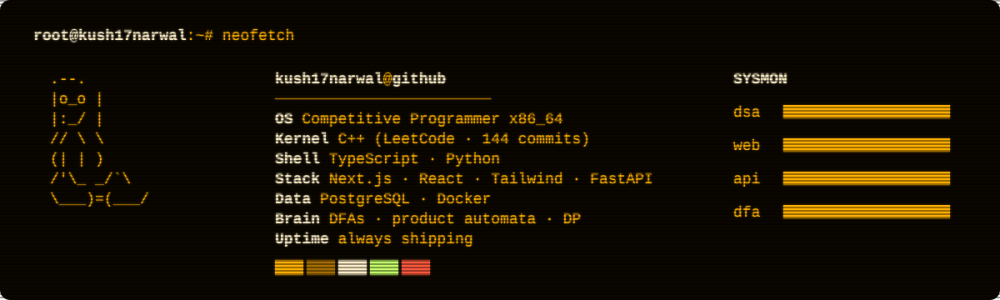

<!-- README 03 · TERMINAL HACKER · Kush17narwal -->
<a href="https://kush17narwal.github.io/readme-showcase/03-terminal-hacker/app/"></a>

<p align="center">
<a href="https://kush17narwal.github.io/readme-showcase/03-terminal-hacker/app/"></a>
</p>

```console
root@kush17narwal:~# whoami
kush17narwal · competitive programmer · full-stack builder

root@kush17narwal:~# cat mission.txt
> grind algorithms in C++ until they're muscle memory
> build web systems end to end: Next.js → FastAPI → PostgreSQL
> use automata theory to catch bots pretending to be human
```



```console
root@kush17narwal:~# ls -la ~/projects
drwxr-xr-x  kush  LeetCode/               # C++ · 144 commits · one dir per problem, indexed by topic
drwxr-xr-x  kush  digital_doppelganger/   # human-or-bot detection · 4 DFAs → product automaton
drwxr-xr-x  kush  prep-zone/              # [empty] · something is compiling...
```

| `$ cd` | PROCESS | STACK | WHAT IT DOES |
|:--|:--|:--|:--|
| [`LeetCode/`](https://github.com/Kush17narwal/LeetCode) | `PID 0015` | C++ | Problems solved and filed by topic: arrays, dynamic programming, binary search and more. |
| [`digital_doppelganger/`](https://github.com/Kush17narwal/digital_doppelganger) | `PID 4DFA` | Next.js · React · TypeScript · Tailwind · FastAPI · PostgreSQL · Docker | Watches how a web session behaves and classifies it as human-like or automated, using four DFAs combined into a product automaton. |
| [`prep-zone/`](https://github.com/Kush17narwal/prep-zone) | `PID ????` | — | Booting. |

```console
root@kush17narwal:~# diag --skills
  cpp.algorithms ......... ██████████  OK
  dsa.patterns ........... █████████░  OK
  web.nextjs+react ....... ████████░░  OK
  api.fastapi ............ ████████░░  OK
  db.postgres+docker ..... ███████░░░  OK
  theory.automata ........ █████████░  OK
  coffee.level ........... ██░░░░░░░░  LOW
```

<details>
<summary><b>root@kush17narwal:~# ./live --help</b> &nbsp;<sub>(click to expand: what the live terminal can do)</sub></summary>

<br>

The live version is a **working shell in the browser**, set in a tmux-style tiling layout:

```text
  help · ls · cd · cat · whoami · neofetch · date · echo · history · clear
  scan              fake network sweep (finds a friendly toaster)
  hack <target>     theatrical progress bars → ACCESS GRANTED
  decrypt <file>    character-by-character "cracking" animation
  diag              system diagnostics
  matrix            toggles full-screen code rain
  theme amber|green|ice
  sudo …            try it
  exit              CRT power-down
```

- BIOS boot sequence, memory test and module loading with progress bars
- **Tab completion**, **↑/↓ history**, `Ctrl+L` and `Ctrl+C`
- Live **sysmon** pane with per-core meters, memory, temps and a network sparkline
- **Code-rain** pane (`matrix` makes it full screen)
- Phosphor glow, scanlines, flicker and a CRT switch-on animation. Motion stops if you prefer reduced motion

</details>

<a href="https://kush17narwal.github.io/readme-showcase/03-terminal-hacker/app/"></a>
